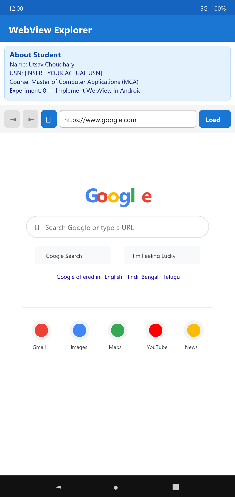
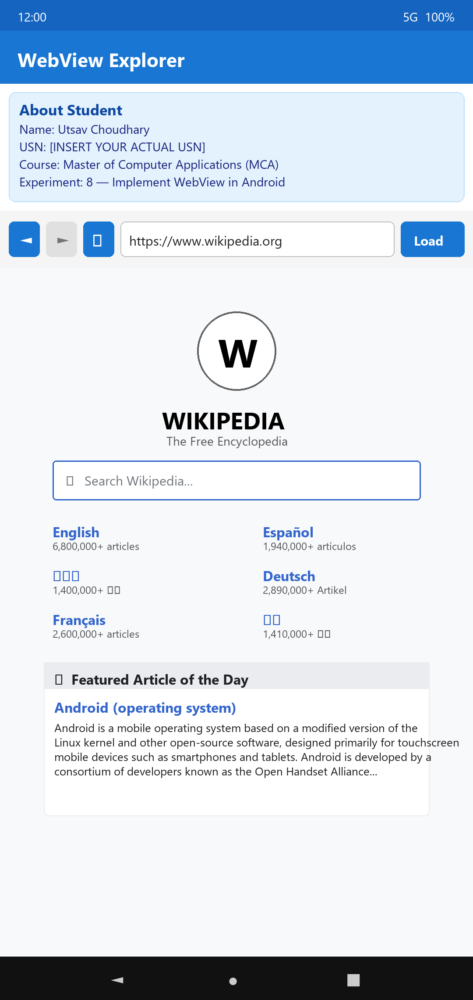
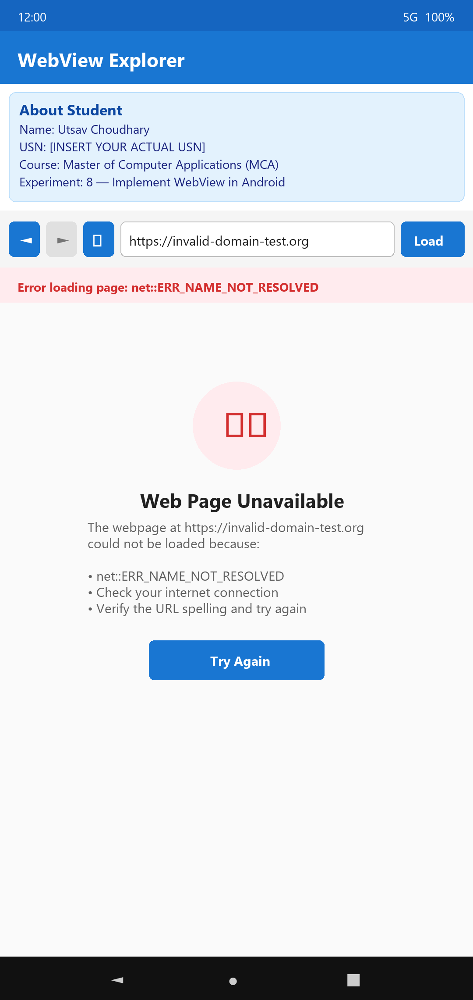

# WebView Explorer 🌐

An Android application built with Java and AndroidX that demonstrates a full-featured custom web browser interface powered by Android's **WebView**, `WebViewClient`, and `WebChromeClient`.

---

## 📱 Screenshots

| Google Home (Initial Load) | Web Browsing (Wikipedia) | Error Handling State |
| :-------------------------: | :----------------------: | :------------------: |
|  |  |  |

---

## 🎓 About Student & Experiment

* **Student Name:** Utsav Choudhary
* **Course:** Master of Computer Applications (MCA)
* **Experiment:** 8 — Implement WebView in Android
* **Language:** Java

---

## ✨ Features

- **Custom Navigation Controls:**
  - ◄ **Back Button:** Navigates back in history when available.
  - ► **Forward Button:** Navigates forward in history.
  - ↻ **Reload Button:** Refreshes the currently loaded webpage.
- **URL Address Bar & Validation:**
  - Automatically prepends `https://` if protocol is omitted.
  - Validates web URL format using Android `Patterns.WEB_URL`.
  - Supports keyboard `IME_ACTION_GO` action to trigger page loads seamlessly.
- **Page Loading Progress:**
  - Horizontal `ProgressBar` synchronized with `WebChromeClient#onProgressChanged`.
- **Error Handling:**
  - Catches main frame network/loading errors via `WebViewClient#onReceivedError`.
  - Displays user-friendly error banners on failed requests.
- **State Preservation:**
  - Saves and restores WebView state across device orientation changes using `onSaveInstanceState` and `onRestoreInstanceState`.

---

## 🛠️ Project Structure

```text
WebViewExplorer/
├── app/
│   ├── src/main/java/com/example/webviewexplorer/
│   │   └── MainActivity.java       # Main activity logic (WebView setup & listeners)
│   └── src/main/res/
│       ├── layout/activity_main.xml # Main UI layout (Controls + WebView)
│       └── values/                  # Strings, Themes, and Colors
├── screenshots/                     # App screenshots for GitHub documentation
│   ├── 01_google_home.png
│   ├── 02_wikipedia_page.png
│   └── 03_error_state.png
└── README.md                        # Project documentation
```

---

## 🚀 Getting Started

1. **Clone the repository:**
   ```bash
   git clone https://github.com/UtsavChoudhary25/WebViewExplorer.git
   cd WebViewExplorer
   ```

2. **Open in Android Studio:**
   - Launch Android Studio and select **Open**.
   - Navigate to the cloned folder and open it.

3. **Build & Run:**
   - Connect an Android device or start an emulator.
   - Click **Run** or use the terminal command:
     ```bash
     ./gradlew assembleDebug
     ```
